# camaenu

An elephant on wheels that finds a red box and lifts it with its trunk, using **cameras and nothing else**.

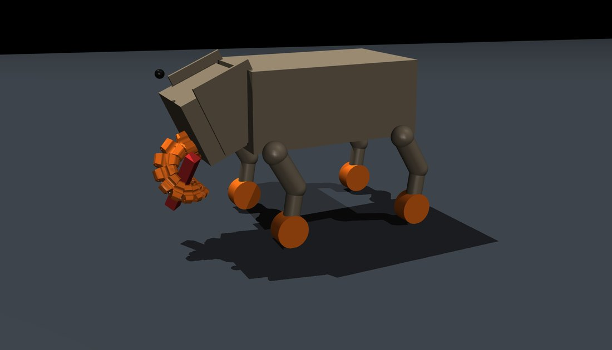

*A screenshot from the MuJoCo viewer: the trunk has curled round the thin red box and the box is off the floor.*

This repository is the camera-only version of an earlier robot that had 45 sensors. Everything the robot knows about the world comes from rendered camera images. This document explains what the robot is, how the sensors were stripped out, how the cameras turn into numbers, how the robot searches, drives and parks, how the trunk grabs the box, how the grab was tuned, and what still does not work.

## Contents

1. [The task and the rules](#the-task-and-the-rules)
2. [The robot](#the-robot)
3. [From 45 sensors to cameras only](#from-45-sensors-to-cameras-only)
4. [Seeing: from pixels to a box position](#seeing-from-pixels-to-a-box-position)
5. [The autonomous stack](#the-autonomous-stack)
6. [The grab, and how it got here](#the-grab-and-how-it-got-here)
7. [Tuning the grab with a search](#tuning-the-grab-with-a-search)
8. [Results and honest status](#results-and-honest-status)
9. [Running it](#running-it)
10. [Settings you can change without editing code](#settings-you-can-change-without-editing-code)
11. [Motor sizing](#motor-sizing)
12. [Repository layout](#repository-layout)
13. [Things that went wrong on the way](#things-that-went-wrong-on-the-way)
14. [Future work](#future-work)

---

## The task and the rules

A wheeled four-legged robot with a cable-driven trunk has to lift a red box off the floor.

| | |
|---|---|
| Box | 3.5 cm x 3.5 cm base, 20 cm tall, 0.5 kg, red |
| Start | The box is somewhere ahead, out of view of the body, position unknown |
| Success | The box leaves the floor and stays in the trunk |
| Rule 1 | No sensors of any kind: no touch, no range finders, no IMU, no joint encoders, no cable-force or cable-length readings |
| Rule 2 | The control code may only read camera images (plus what the robot itself commanded) |
| Rule 3 | Ground truth from the simulator may be used to test and tune, never in the control path |

Rule 3 is enforced by file layout. Everything in `sim/` is the robot's brain and uses only images. Everything in `dev/` is allowed to cheat (read the true box pose) because it only scores runs.

## The robot

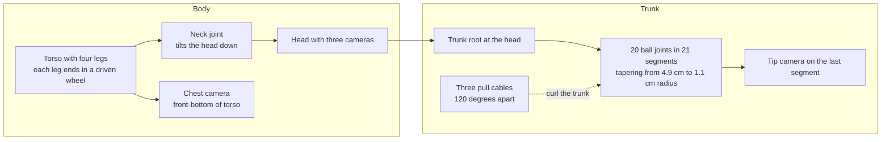

| Part | Detail |
|---|---|
| Locomotion | Four legs, each with a hip, a knee and a driven wheel. The robot drives and spins in place on wheels. About 0.26 m/s per unit of drive command, and roughly 14 to 20 degrees per second of spin at full rate |
| Trunk | 0.47 m long when straight, root at 0.44 m ahead of the torso centre. 20 ball joints, each limited to 30 degrees. Stiffness is tapered so the tip is far softer than the root |
| Cables | Three force-controlled cables. Pulling one side curls the trunk toward it. The curl direction is set by an azimuth angle: 0 degrees is straight ahead and down, 180 degrees is up, plus or minus 90 degrees is sideways |
| Actuators in the trunk path | Neck bend, trunk bend, trunk extension (0 to 12 cm), and the three cable forces. Knee crouch lowers the whole front |
| Softened trunk | Stiffness scaled so a real motor could do the job: root stiffness x0.25, tip stiffness x0.25 too through a geometric taper, cable force capped at 30 N |

## From 45 sensors to cameras only

The robot started as a sensor-heavy build. A rangefinder mast on the head, a rangefinder array on the chest, touch pads along the trunk, an IMU, and encoders on every joint and cable. A state machine of about 800 lines read all of that to decide what to do.

Everything was removed, and the model now asserts at import that it has zero sensors.

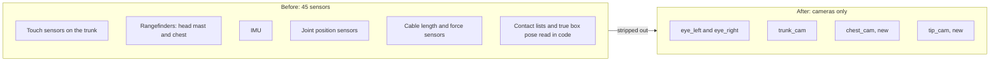

| Removed from the model | Count |
|---|---|
| The whole sensor block (touch, rangefinder, IMU, joint position, cable length, cable force) | 45 sensors |
| The head rangefinder mast and its rangefinder sites | 1 body, 9 sites |
| The chest sensor body and its rangefinder sites | 1 body, 5 sites |
| IMU site | 1 |
| Trunk touch sites and tip rangefinder site | 8 sites |

Kept on purpose: the foot sites (the leg inverse kinematics uses them as geometry) and the cable routing sites (they define the tendon paths, so they are geometry, not sensors).

In the code, the touch, rangefinder, IMU, contact-list and true-box-pose reads are gone from the control path, and the old rangefinder and reposition state machines were deleted. What replaced them is the camera pipeline below.

### Cameras

| Camera | Mounted on | Used for |
|---|---|---|
| `eye_left`, `eye_right` | Head, either side, tilted 25 degrees down | Search and far approach (works past 5 m) |
| `trunk_cam` | Head, face level, 40 degrees down | Mid-range approach |
| `chest_cam` (new) | Torso front-bottom, 35 degrees down, wide 85 degree lens | Close range, parking, the lift check |
| `tip_cam` (new) | Last trunk segment, looking along the tip | Image cues only: is the box in view, how much of the frame it fills |
| `overview` | Fixed in the world | Humans and debugging only. The robot never uses it |

Two physics bugs surfaced while making the robot move on cameras alone, and both were fixed in the model file:

1. The wheels sometimes drove backward when told to go forward, in about 8 of 10 starts. The wheel velocity servo was far too stiff for the 2 ms time step and chattered once force limits kicked in. Lowering the velocity gain from 8 to 1 and raising the wheel armature from 0.001 to 0.01 made it go forward in 10 of 10 starts.
2. Spinning in place could throw a front hip to its limit in about 1 of 10 starts. Lowering wheel friction from 1.6 to 1.0 held in 32 of 32 trials and also turned faster.

## Seeing: from pixels to a box position

The cameras give images. `sim/vision.py` turns them into a position in the robot's own frame.

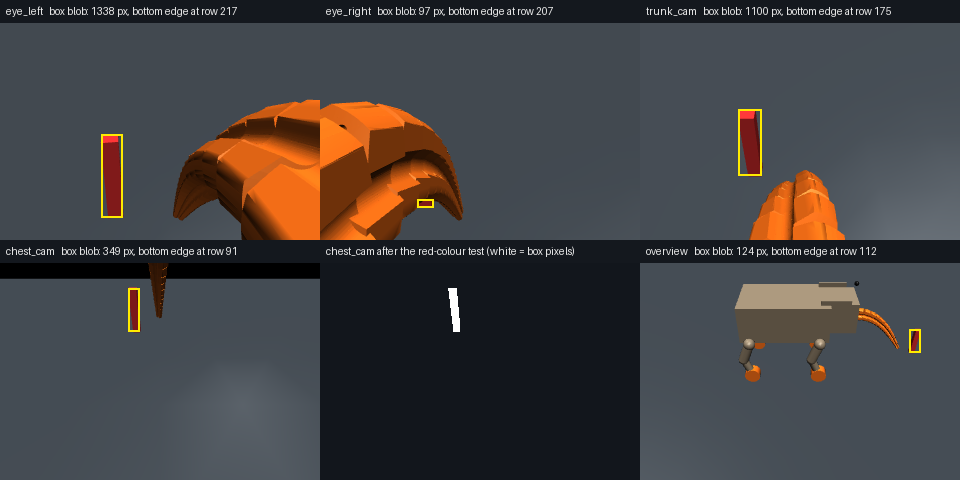

*Top row: the two eye cameras and the trunk camera. Bottom row: the chest camera, the same chest image after the colour test, and the overview camera (humans only). The yellow rectangle is the box found by the robot. The trunk, the orange blocks in the foreground, is in view of some cameras.*

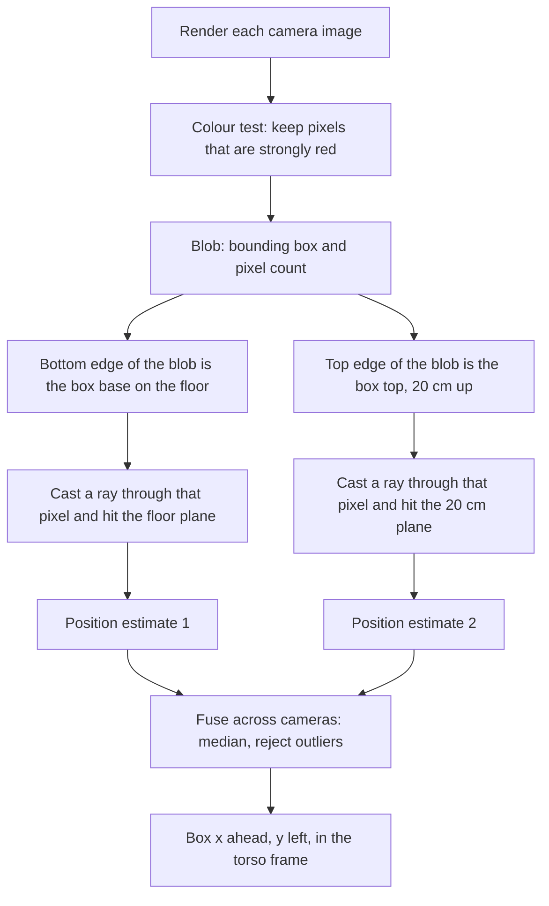

How it works, in plain terms:

1. **Find the box.** The box is the only strongly red object. Pixels with red much larger than green and blue are kept. The orange trunk and wheels have too much green, and the brown body is rejected too.
2. **Turn a pixel into a place.** The bottom edge of the red blob is where the box meets the floor. A ray through that pixel, using the camera's own pose and focal length, hits the floor plane at a known point. Add half the box width and that is the box centre. The top edge gives a second, independent estimate on a plane 20 cm up.
3. **Fuse.** Estimates from several cameras are combined with a median and outliers are thrown away. The result is smoothed, and one-frame jumps are ignored.
4. **Close range fix.** At 30 to 80 cm the chest camera showed a systematic sideways bias. A straight-line correction fitted at 44 to 54 cm ahead and 5 to 13 cm to the side keeps the residual error under about 1 cm.

Only two kinds of prior knowledge are used: the box size and colour, and where the cameras sit on the body. Camera poses relative to the torso come from the robot's own link geometry and its wheel-hub positions, which is body knowledge, not world sensing.

Measured against the simulator's true box pose (in `dev/`), the estimates are within 1 to 4 cm out to 3 m, and under 10 cm at 5 m.

## The autonomous stack

`sim/elephant_grasp_cv.py` is a state machine driven entirely by those estimates.

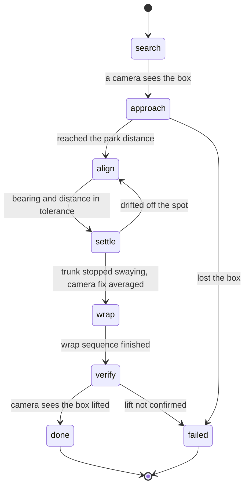

| State | What it does |
|---|---|
| search | Spins in place until any camera sees the box |
| approach | Steers on the box bearing and drives on forward distance. Large heading errors are removed by spinning first, because the robot's driving turn radius is about 1.5 m. It aims not at the box but at a spot 20 degrees to one side of it |
| align, settle | Squares up on that spot, stops, lets the trunk stop swaying, and averages the camera fix |
| wrap | Runs the grab sequence (next section) with the cameras watching |
| verify | Takes a median of several chest-camera looks at the box base height. Only a camera-confirmed rise counts as success |

Why park to one side at an angle? The trunk root is thick, and a thick root cannot wrap a thin box. The robot has to bring the box to the thinner, more flexible part of the trunk, from the side, without the trunk touching it on the way in. Approaching straight on knocked the box over in several runs.

## The grab, and how it got here

The grab is an open-loop, cosine-eased sequence in `sim/grasp_sequence.py`. It is open loop on purpose: there are no touch or force readings left to close it with. The cameras decide where the robot stops and when the turn is finished; after that the sequence plays out.

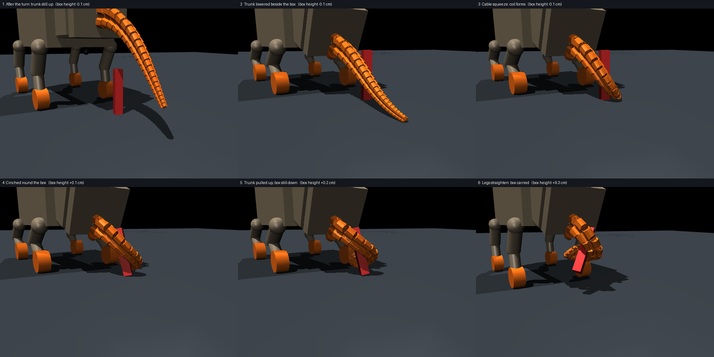

*A headless render of one run with the final settings. The height shown in each title is the box centre's rise above its starting height.*

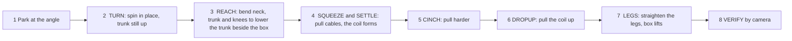

### How the robot gets the box into the trunk

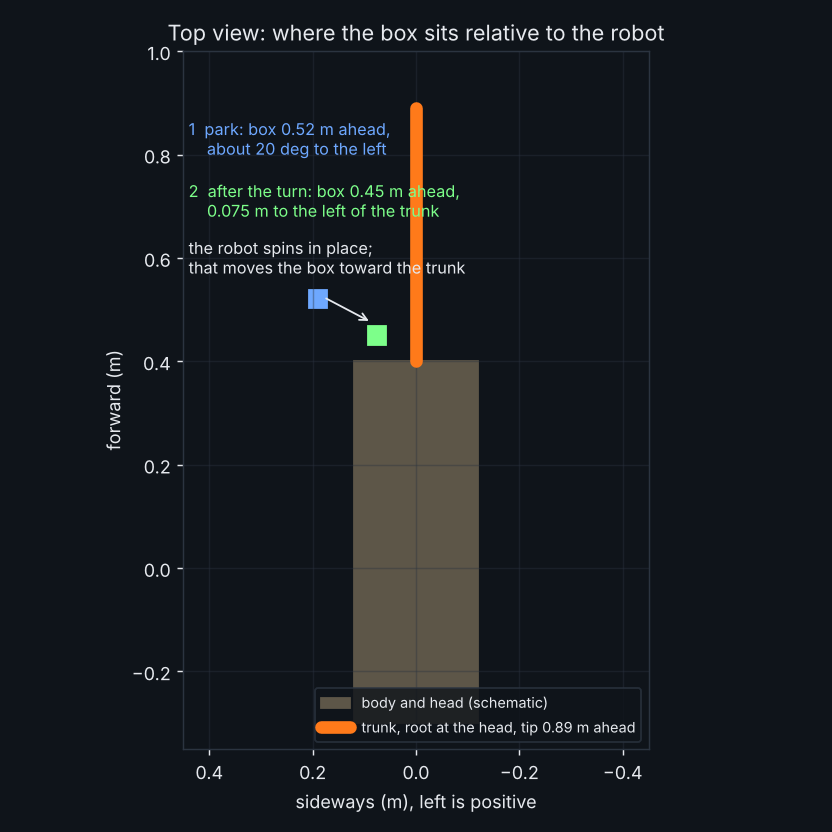

1. The robot parks with the box 0.52 m ahead and about 20 degrees to the left, so the trunk is well clear of it.
2. It spins in place, watching the box with the chest camera, until the box sits about 0.055 m to the side of the trunk line. Spinning moves the box toward the trunk without the robot driving forward, so the trunk's side sweeps into the box from the side, not the front.
3. Only then does it bend the neck and knees to lower the trunk. If the neck bends first, the head cameras move with it and bias the box estimate, and the trunk can land on top of the box.
4. The cables pull, the trunk curls round the box, and the legs straighten to lift.

### The path to this design

The design was found by repeating the same loop: run, look at the viewer, see what went wrong, change one thing. The screenshots below are from the actual runs on a Mac.

**The first attempts: the trunk lunged and the box went down.** The original wrap pushed the trunk onto the floor and the box toppled. The robot "bends down, knocks the box over, then snaps back to its normal pose".

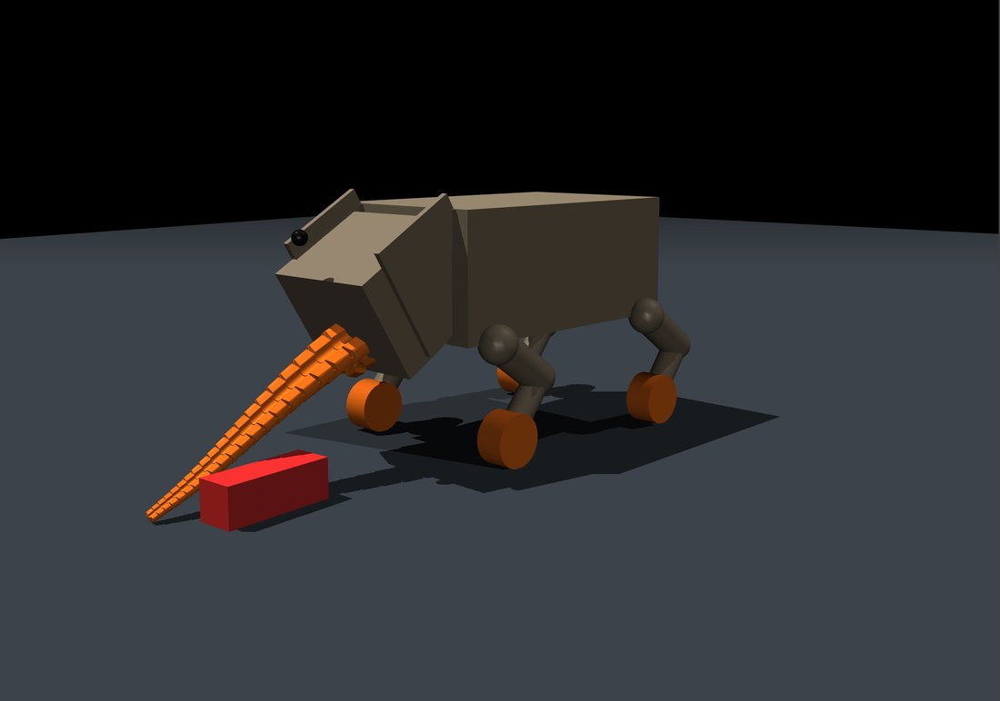

**The key idea came from watching those runs.** Park with the box 10 to 20 degrees to one side, lower the trunk beside it with the knees and neck, then curl round it. That became the pipeline above.

**Too close to the thick root.** The robot stopped too near, so the thick part of the trunk met the box and could not grip. The park distance was moved back so the thinner, softer part of the trunk does the gripping.

**The trunk landed on top of the box.** Lowering the trunk with the box straight ahead put it above the box. Turning the robot by an angle first fixed that.

**The wheels drove forward after the turn.** An earlier version rolled the robot forward after turning, which undid the lateral move. That forward drive was removed and the park distance changed instead, so the turn alone brings the box into place.

**The coil closed above the box, near the head.** The estimate of the box position moved by about 6 cm when the trunk and knees lowered, because the head cameras move with the neck. The wrap now uses only the torso-mounted chest camera, and the turn waits for a fresh fix taken after the reach.

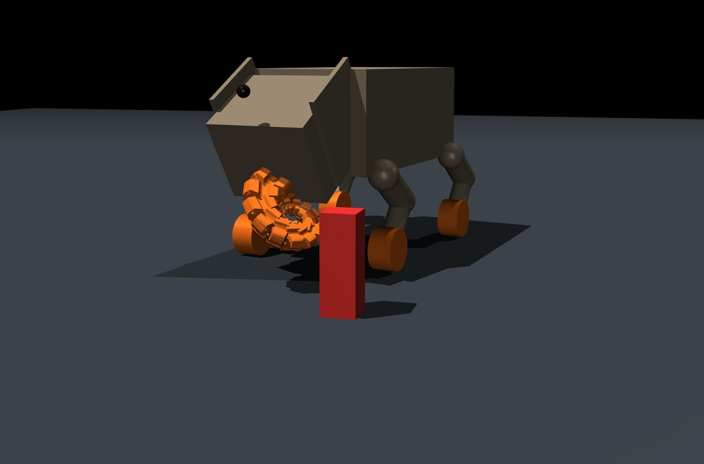

**Close, but the cinch pulled the box over.** With the box about 6 to 10 cm too far out the trunk caught it with its tip only, and the cinch dragged and toppled it.

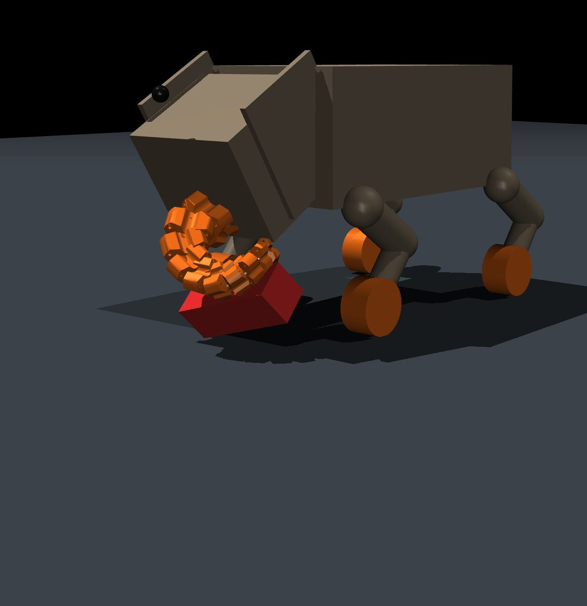

**A softer trunk and weaker cables.** The first trunk was a real elephant's opposite: very stiff, with 60 N cables that no small motor could pull. Stiffness was scaled down along the trunk and the cables were capped at 30 N, which is achievable with a hobby servo (see [Motor sizing](#motor-sizing)).

**A thinner box.** The base was halved to 3.5 cm by 3.5 cm, which puts the box's near face closer to its own centre and needs a smaller sideways offset (0.055 m instead of 0.07 m).

**Turn first, then bend the neck.** The order was swapped to turn first and lower the trunk after. This got the trunk beside the box instead of on top of it.

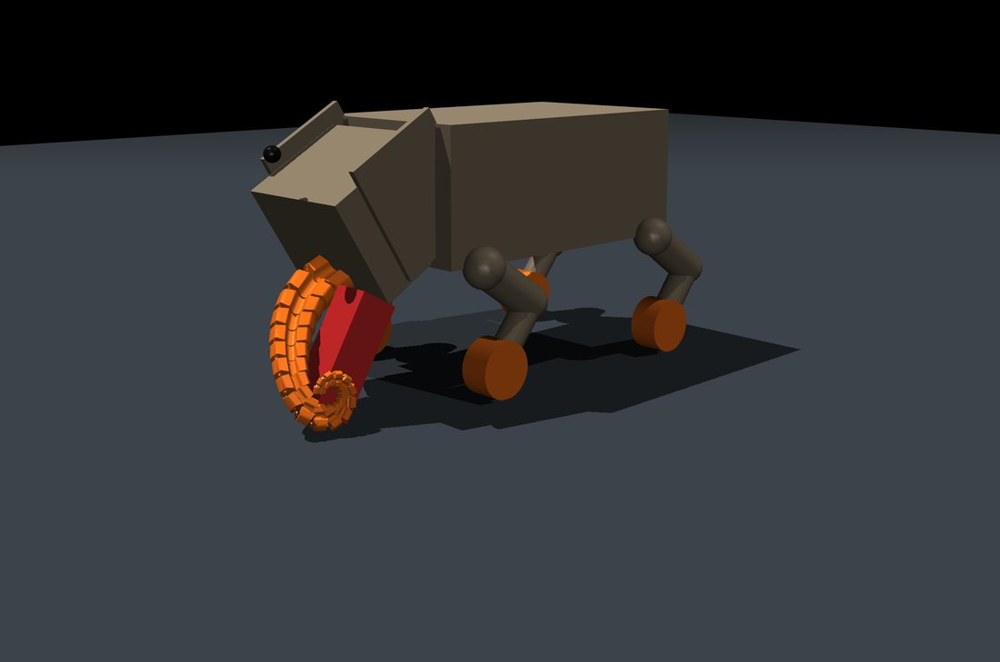

Then the settings were searched, as described next.

## Tuning the grab with a search

Hand-tuning had hit a wall. A change of one centimetre in where the robot stopped decided between a lift and a toppled box. So the settings were searched in simulation.

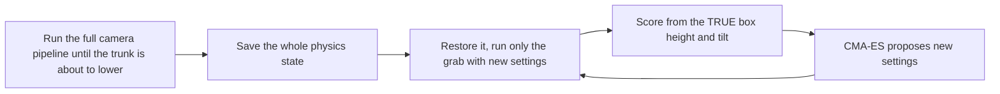

| What | Detail |
|---|---|
| Search method | CMA-ES, a standard black-box optimiser, population 8 |
| Settings searched | Neck bend, trunk bend, trunk extension, crouch depth, the three cable pulls (squeeze, cinch, lift), curl direction, and two timings. Ten values |
| What it was scored on | Six saved start states taken from the real camera pipeline, spanning the range of positions the robot actually ends up in |
| Score | Box height gain if the box ended upright, plus a bonus for the worst of the six, so one lucky start could not win |
| Cheating allowed | The score reads the true box pose. This lives only in `dev/`, never in `sim/` |

A first version of the score rewarded contact, and the search happily found settings that "touched" the box by knocking it flat. The score was changed to reward only a box that is off the floor and still upright. That is classic reward hacking, and it is why the rewards here count height, not touching.

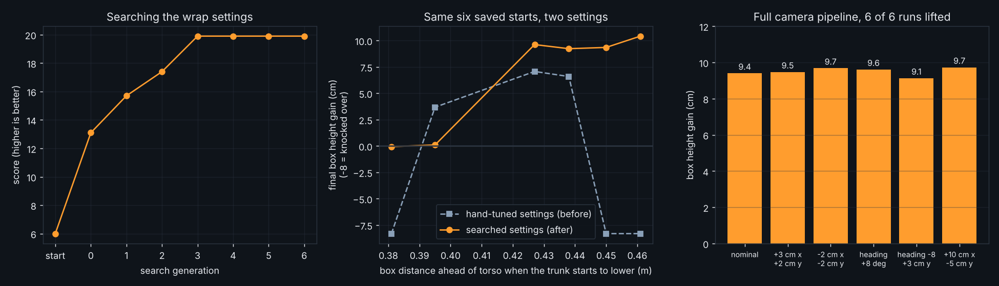

*Left: the score climbing over generations until it stopped improving at generation 3. Middle: on the same six saved starts, the hand-tuned settings lifted only in a narrow band of positions, while the searched settings lift over a wider one. Right: the full camera pipeline with the final defaults, six runs with different start offsets and headings.*

## Results and honest status

| Test | Result |
|---|---|
| Full camera pipeline in simulation, final defaults, 6 runs with start offsets of up to 10 cm and heading changes of 8 degrees | **6 of 6** lifted the box by 9.1 to 9.7 cm. The camera's own lift check confirmed all six (state `done`) |
| Same six saved starts, before and after the search | Before: 3 of 6 lifted (up to 7 cm). After: 4 of 6 (9 to 10 cm). The two that fail are the starts where the box is farthest from the root |
| Estimates against ground truth | 1 to 4 cm out to 3 m |
| A Mac run with the searched settings | The viewer showed the box held in the coil (the screenshot at the top). The final defaults in this repo (park at 0.52 m) were produced after that run and have not been run on a Mac |

What is not solved, plainly:

- **It lifts about 9 cm, and the box ends tilted.** The box finishes at roughly 30 degrees from upright, held in the coil, not carried cleanly.
- **It is fragile.** The grab is open loop. Rounding a setting from 24.2116 to 24.21 changed which of the six saved starts lifted. A park distance 1 cm off could topple the box in earlier versions. The searched settings are far more forgiving than the hand-tuned ones, but this is a narrow window, not a solved problem.
- **The search is not finished.** It stopped improving after four generations and was ended after seven of ten planned ones.
- **Mac results differ a little from the simulator on a cloud machine.** Treat the numbers above as simulation results.
- **One kind of box, one kind of floor.** Red box, flat floor, one starting direction family.

## Running it

You need Python and MuJoCo. On macOS use `mjpython`, which opens the viewer.

```bash
python3 -m venv .venv && source .venv/bin/activate
pip install mujoco numpy
cd sim
mjpython autopilot_boxlift_cv.py        # macOS
# python autopilot_boxlift_cv.py        # Linux, Windows
```

Click the viewer window, then:

| Key | Action |
|---|---|
| G | Start the autonomous search, approach and grab |
| X | Abort |
| Arrow keys | Drive by hand |
| ESC | Quit |

The terminal prints the box estimate once a second and a line at each stage. The lines to look at are:

```
[STACK] camera fix at wrap start: x=... y=...
[STACK] turn done in ... s -- camera: box now ... m ahead, ... m left
[BOXWRAP] phase: REACH / SQUEEZE / SETTLE1 / CINCH / HOLD / DROPUP / HOLD2 / LEGS / CARRY
[STACK] VERIFY: lift (camera, median of ... looks) = ... cm
```

Offscreen cameras need OpenGL. On a machine without a display, set `MUJOCO_GL=osmesa` (or `egl`). Software rendering is slow, so `STACK_RENDER_EVERY=25` and `VISION_FRAME=160x120` trade camera rate for speed.

To reproduce the simulation tests (these read ground truth and live in `dev/`):

```bash
cd dev
MUJOCO_GL=osmesa python3 e2e_test.py 1.05 0 0        # one full run from a start position
MUJOCO_GL=osmesa python3 diag.py 1.05 0 0            # prints the true box pose at every phase
MUJOCO_GL=osmesa python3 tune_run.py                 # one run, one scored result line
pip install cma && MUJOCO_GL=osmesa python3 cma_wrap.py 10   # the settings search (needs saved starts from tune_snap.py)
```

## Settings you can change without editing code

All are environment variables, for example `PARK_X=0.55 WRAP_LATERAL=0.05 mjpython autopilot_boxlift_cv.py`.

| Variable | Default | Meaning |
|---|---|---|
| `PARK_X` | 0.52 | How far ahead the box is when the robot stops (m). The most sensitive setting |
| `PARK_ANGLE` | 20 | How far to the side the box is when parked (degrees). Positive is left |
| `WRAP_LATERAL` | 0.055 | Sideways offset the turn aims for (m) |
| `WRAP_NK`, `WRAP_TP`, `WRAP_TD`, `WRAP_CR` | 24.21, -71.14, 0.1095, 0.0886 | Neck bend (deg), trunk bend (deg), trunk extension (m), crouch (m) |
| `WRAP_M1`, `WRAP_M2`, `WRAP_M3` | 10.2, 19.56, 29.95 | Cable pull while squeezing, cinching and lifting (N) |
| `WRAP_PSI` | 42.96 | Curl direction (deg). Mirrored automatically for a box on the right |
| `WRAP_T_REACH`, `WRAP_T_UP`, `WRAP_T_LEGS` | 4.0, 4.99, 4.61 | Timings (s) |
| `WRAP_ADV` | 0 | Optional forward creep before curling (m). Off by default |
| `WRAP_ADV_TIMEOUT`, `WRAP_CONTACT_X`, `WRAP_CONTACT_Y` | 12, 0.50, 0.10 | Only used if `WRAP_ADV` is on |
| `WRAP_TURN` | 1 | Set to 0 to skip the turn |
| `TRUNK_STIFF` | 0.25 | Trunk softness (1 is the original stiff trunk) |
| `CABLE_MAX_N` | 30 | Cable force cap (N) |
| `STACK_RENDER_EVERY` | 15 | Physics ticks per camera frame |
| `VISION_FRAME` | 320x240 | Camera resolution |
| `ELEPHANT_PYNPUT` | unset | Set to 1 to use a global key listener instead of the viewer's own key handler |

The viewer's own key handler is the default. The global key listener crashed the viewer on some macs.

## Motor sizing

The first design asked for 60 N on each cable, which is not a hobby-servo number. The cable force is the motor torque divided by the spool radius, `F = torque / r_spool`.

A Dynamixel XL430-W250-T is a reasonable fit: 1.4 N m stall torque at 11.1 V, about 1.3 A, 57 g, multi-turn range, and a PWM mode for force-style control. With a spool of 2 to 3 cm radius, that is roughly 45 to 70 N at stall, so a 30 N working cap leaves a comfortable margin. A standard MG996R hobby servo only turns 180 degrees, which is too little cable travel for a coil. Cable travel in this trunk is about 6 to 12 cm.

## Repository layout

```
sim/                         The robot's brain and body. Cameras only.
  robot_elephant_quadruped.xml   The model: body, trunk, cables, cameras, box. No sensors.
  meshes/                        Trunk segment meshes
  quadruped_grasp_core.py        Loads the model, actuator helpers, trunk softening, key handler
  walk_gait.py, leg_ik.py        Leg kinematics and stance
  wheel_drive.py                 Wheel velocity targets for driving and spinning
  vision.py                      Camera rendering, colour test, ray geometry, fusion
  grasp_sequence.py              The grab choreography and its settings
  elephant_grasp_cv.py           The state machine: search, approach, park, wrap, verify
  autopilot_boxlift_cv.py        The viewer program you run

dev/                         Test and tuning tools. These read ground truth.
  ground_truth_eval.py           True box pose, used only to score
  e2e_test.py, diag.py           End-to-end runs and per-phase diagnostics
  tune_run.py, tune_snap.py      One scored run; save a physics state at the start of the reach
  feas3.py, cma_wrap.py          Run only the grab from a saved state; the settings search
  scan.sh, show.py               Run several configurations in parallel; print them compactly
  make_figures.py, make_charts.py  Produce the images in docs/
  cma_best.json                  The best settings the search found
  earlier_searches/              Scripts from earlier versions of the search (older box and trunk)

docs/images/                 Figures and viewer screenshots used above
```

## Things that went wrong on the way

- **The viewer crashed on open.** A global keyboard listener thread crashed it on macOS. Using the viewer's own key callback fixed it.
- **"Toppled" and "pushed" alarms fired falsely.** With the trunk curled round the box, the cameras see only part of it, so the box looked flat or moved. The alarms aborted good grabs, so they were removed.
- **The camera lift check is conservative.** A curled trunk can hide the box base, so it sometimes calls a real lift "not confirmed". Judge by what the viewer shows.
- **The head cameras move with the neck.** Using them during the wrap shifted the box estimate by about 6 cm. The wrap uses only the torso-mounted chest camera.
- **The search rewarded the wrong thing.** See [Tuning the grab with a search](#tuning-the-grab-with-a-search).
- **Ordering matters more than it looks.** Turning before bending the neck, and parking to one side, each turned a failure into a lift.

## Future work

### Closing the loop

The grab in this repository is an open-loop, hand-parameterised sequence. Its ten settings were tuned in simulation by CMA-ES, but the controller never uses what it sees after the reach begins. The result is a narrow success region: a change of about 1 cm in the park position, or a rounding change in a setting, can flip a run from a lift to a toppled box (see [Results and honest status](#results-and-honest-status)). Closing the loop with the existing camera stream is the most direct way to widen that region.

### Learning the grab with reinforcement learning

We propose to replace the fixed sequence with a policy trained by reinforcement learning, under the same constraint used throughout this work: the policy may observe only camera-derived quantities and its own commands. No contact, force, encoder or inertial signal is available to it at deployment.

**Formulation.** The task is an episodic partially observable Markov decision process. An episode starts from the parked, aligned state produced by the camera pipeline and ends when the box is lifted, dropped or toppled, or when a time limit is reached.

| Element | Proposed definition |
|---|---|
| Observation | Box position and bearing from the chest camera, box blob area and bounding-box aspect from the chest and tip cameras, whether the box is visible, a short history of these, and the policy's own previous commands (neck, trunk, crouch, cable targets, turn rate). No joint or contact readings |
| Action | Small per-step changes to the commanded neck bend, trunk bend and extension, crouch, the three cable forces (within the 30 N cap) and the turn rate, rate-limited so the policy cannot command impulsive motions |
| Initial states | The saved REACH-entry states already used by the tuning search, extended with randomised park distance (about 0.45 to 0.60 m), angle, and box placement |
| Reward | Evaluated from simulator ground truth during training only: height gain of the box while it stays upright (primary); a small shaping term for the trunk tip approaching the box; penalties for toppling, for large box displacement during the reach, and for cable force above the cap |
| Algorithm | PPO or SAC, warm-started by behaviour cloning of the scripted wrap so that training begins from a policy that already lifts in part of the state space |
| Critic | Asymmetric: the critic may see the true box pose, the actor sees cameras only. Ground truth is used for learning and never reaches the deployed policy |

**Reward design risk.** The earlier parameter search illustrated reward hacking directly: a score that rewarded contact found settings that touched the box by knocking it flat. The reward above therefore counts height gained while upright and treats contact only as a weak guide. Reward terms and weights remain to be chosen and ablated.

**Sim-to-real.** Domain randomisation over lighting, box colour tolerance, camera pose error, friction and cable stiffness is planned, together with latency and image-noise models on the chest-camera stream.

**Evaluation.** Success rate and lift height over a held-out set of start poses, compared against the scripted wrap and the CMA-tuned wrap, with the same six-start protocol used in this repository, then a wider sweep of park distance and heading. The main hypothesis is that a closed-loop policy widens the range of park positions from which the box is lifted and keeps it upright, rather than only raising the lift height.

**Status.** No training environment has been built. The environment, observation set and reward are described here as a design, not as results.

### Hardware and carry quality

The box currently ends tilted about 30 degrees from upright, held in the coil. A better coil position or a hook-shaped tip may keep it upright. Cable motors and spools are sized in [Motor sizing](#motor-sizing); a hardware build would also need a real chest camera whose pose error is within the tolerance assumed by the close-range correction.
